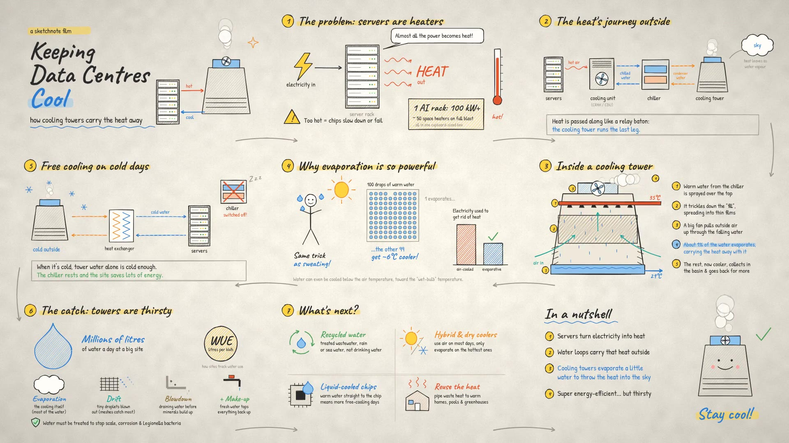

# Keeping Data Centres Cool: a sketchnote film



A 2 min 19 s hand-drawn explainer, `cooling-towers-sketchnote.mp4` (1080p, 30 fps, with soundtrack),
about how cooling towers remove heat from data centres.

The film is one big sketchnote page with nine panels. A marker pen draws each panel live while the
camera moves through them. At the end the camera pulls back to show the whole sheet.

| # | Panel | Key idea |
|---|-------|----------|
| – | Title | Keeping Data Centres Cool |
| 1 | The problem | Servers turn almost all their power into heat; one AI rack can produce 100 kW+ |
| 2 | The heat's journey | Servers → CRAH/CDU → chilled-water loop → chiller → condenser-water loop → cooling tower → sky |
| 3 | Inside a cooling tower | Spray → fill → fan-driven air → ~1% evaporates → cooler water (35 °C in, 29 °C out) |
| 4 | Why evaporation works | Like sweating; evaporating 1% cools the other 99% by about 6 °C; much less energy than air cooling |
| 5 | Free cooling | On cold days the tower alone is cold enough, so the chiller can switch off |
| 6 | The catch: water | Evaporation, drift and blowdown losses; make-up water; WUE; water treatment |
| 7 | What's next | Recycled water, hybrid/dry coolers, warm-water liquid cooling, heat reuse |
| 8 | In a nutshell | Recap: "Stay cool!" |

## How it's made

Everything is generated in code, with no stock footage or drawings.

- `src/film.js`: the scene and animation engine. Shapes are drawn with [rough.js](https://roughjs.com)
  for the hand-drawn look, and the text uses the handwriting fonts Caveat and Patrick Hand. Every frame is a pure
  function `render(t)`. Strokes draw on with dash offsets and text is revealed with a wipe, while a marker pen
  follows the drawing point.
- `src/render.js`: renders the frames with headless Chromium (Playwright) across 4 workers and pipes them to ffmpeg.
- `src/music.py`: synthesises the soundtrack with numpy: a lo-fi pad, bass and plucked arpeggio, plus
  pen-scratch sounds timed to the drawing, whooshes on camera moves and a chime at the reveal.
- `src/snap.js`: renders still frames at chosen times for previewing, e.g. `node snap.js 10 25.5`.

### Rebuild

```bash
cd src
npm install            # rough.js + fonts (Playwright/Chromium must be available)
node render.js 4       # -> seg_*.mp4, segs.txt, film_meta.json
python3 music.py film_meta.json soundtrack.wav
ffmpeg -f concat -safe 0 -i segs.txt -i soundtrack.wav -map 0:v -map 1:a \
  -c:v libx264 -crf 21 -tune animation -pix_fmt yuv420p -c:a aac -b:a 192k -shortest \
  -movflags +faststart ../cooling-towers-sketchnote.mp4
```
